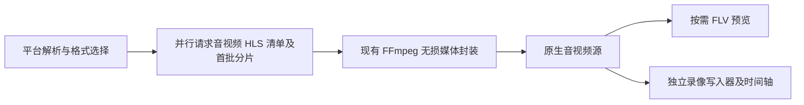

# YouTube 源架构调整与验收

日期：2026-10-18，北京时间。实现位于当前工作区，后端已构建；未发布安装包，未重启已经退出的开发应用。测试直播为用户提供的 `rFZHOHl-L8A`，匿名访问，隔离临时数据库和媒体，不读取用户保存的凭据。

## 当前方案

已撤回“关闭后保留 30 秒、最多一个会话”的预览方案。无人观看且无录制时沿用现有 2 秒释放流程。本次改动处理重复初始化、音视频网络请求串行、解析器进程启动开销三个来源。



- `YoutubeHlsSource` 使用项目既有网络层和代理，同时准备两个输入。FFmpeg 从仅监听本机的临时入口读取，保留原播放列表、分片顺序及默认起播位置；不以跳过更多直播内容提速。后续分片按背压流式传输。
- `YoutubeRecordingEngine.forkRecording()` 允许同画质录像订阅正在播放的原始媒体。`YoutubeNativeRecordingEngine` 复用项目缓冲写盘、分段清单和恢复流程，只重定位 Cluster 时间戳，保留音视频包及编码。无需再次下载、解析、启动封装进程。停止录制不打断观看；没有观看者时停止预览处理，录像继续。
- 共享要求实际源分辨率满足请求画质；预览低于原画等条件不满足时走正常启动流程，避免把播放副本冒充原画。小分辨率选轨沿用 yt-dlp 已排序格式的选择顺序，保留原音轨。
- macOS 使用同版本 `2026.08.19` 的官方 `yt-dlp_macos.zip` 目录运行时，替代每次启动需要展开的单文件程序。归档校验 SHA-256，展开后的完整文件树再次对照固定哈希；校验覆盖被修改、缺失、新增的文件及越界链接。Windows/Linux 保持既有打包方式。

这些变化接入原有平台、录制引擎、管理器和 WebSocket 协议；其他平台继续使用既有路径。

## 定位证据与实测

所有数字为后端首媒体数据的墙钟耗时，并非严格的屏幕首帧时间。短时单次样本受网络、分片时机、系统文件及签名验证缓存影响，不构成延迟上限。

同一份媒体信息的网络输入对照实验中，直接 FFmpeg 输入首预览 11.353 秒，并行准备输入 5.177 秒，两份媒体解码通过。这一对照排除了平台解析，说明两路输入初始化是可处理的主要瓶颈之一。

同版本解析器 `--version` 三次启动：单文件 6.837/5.643/5.353 秒；目录包 6.070/0.500/0.523 秒。首次系统验证仍可能慢，目录包主要消除每次启动反复解包的成本。

| 最终生产链路测量 | 平台解析 | 首媒体数据 |
| --- | ---: | ---: |
| 独立进程冷预览，1080p | 5.127 秒 | 8.897 秒 |
| 独立进程冷录制，720p | 3.891 秒 | 8.713 秒 |
| 独立进程冷录制，1080p，两轮 | 7.323 / 8.444 秒 | 11.038 / 11.944 秒 |
| 同进程已解析信息，纯预览，720p/1080p | 0～1 毫秒 | 2.647～4.157 秒 |
| 已播放预览转录制，1080p / 随包 720p / 原画 | 无新解析 | 6 / 11 / 8 毫秒 |

冷预览那一轮分阶段：平台解析结束 5.127 秒，清单准备好 6.392 秒，初始分片准备好 8.612 秒，原生媒体就绪 8.797 秒，预览首数据 8.897 秒。余下等待主要来自平台解析与网络分片；本地媒体初始化已不再占据十几秒。

最后一行是正在工作的源挂接录像，不能作为冷启动成绩。随后保存的原文件及预览回放均解码成功。原始数据见 [最终启动测量](youtube-root-startup-benchmark.json)、[完整业务验收](youtube-root-lifecycle.json)。旧实现的 20～40 秒及失败记录保留在 [历史报告](youtube-startup-performance.md)，不与不同画质、网络样本直接计算提速百分比。

## 性能与边界

2026-10-22 更新：临时 HLS 初始分片预取最多 4 个，改为有背压的流式交付，不再等整段下载完成才提供给 FFmpeg。每个 PassThrough 读写侧高水位为 1 MiB，超过高水位暂停上游读取；内存还包括当前数据块和网络层缓冲，不能把高水位总和当成进程内存硬上限。未被消费的预取 10 秒过期时取消请求并销毁队列，大分片也沿同一流式请求传输，无需丢弃后重复下载。此缓冲只服务当前初始化，不在关闭预览后保留来源。路由最多 4096 项且地址总量最多 8 MiB；清单每份最多 2 MiB；本机请求并发最多 8。停止会取消请求并关闭本机服务。最新启动测量与边界见 [本轮提速记录](youtube-preview-speed-2026-10-22.md)。

原生录制挂接保留当前完整关键帧组，连同媒体头最多 8 MiB；超限不走共享。一个来源最多挂接一个录像消费者；消费者积压超过 8 MiB 时独立报错并走既有录像恢复，避免阻塞观看或无限增长。实际全链路内存还包含网络层、解析器、播放器、现有队列及 FFmpeg，不能把上述单项上限当成进程总内存。

带 Cookie、过期/过大媒体快照、未知选择表达式、不安全地址/请求头及不支持的输入保留原下载器回退，未对会员或授权流证明同样的延迟收益。签名媒体地址不进入公开 API、报告和日志。

macOS 目录资源展开约 130 MB，原单文件约 37 MB；下载归档约 54 MB。实际安装包压缩体积、签名及首次系统验证仍需安装包验收。

## 验证与未完成事项

三轮隔离真实应用验证覆盖：预览、原生源转录制、精彩片段、聊天落盘及媒体时间、录制中回看与标记、停止后预览、历史回放解码。随包 FFmpeg 4.4 的 720p 和原画轮额外关闭观看后验证录像继续增长、重新进入及同源播放；原画轮也校验预览与录像时间轴偏移可用。原画轮保存 78 条聊天，录像状态 completed。真实媒体回归验证录像从零附近起播，原始音视频包哈希保持，未重新下载或降画质。

后端全量回归 1187 项通过、1 项失败，失败仍为在原始 HEAD 复现的 `qa-exit.test.ts:168` 抖音告警三票断言。构建通过；项目脚本回归 51 项通过，运行时完整性最终 2 项再次通过。最终六个相关测试文件的 103 项回归全部通过，覆盖输入选择、并行 HLS、网络、管理器、预览生命周期及真实 FFmpeg 媒体。工作区 `git diff --check` 通过。前端 TS 本轮未改，上一轮完整回归 572 项通过。

两小时录制、断网恢复长稳、多直播并发负载、原生 WebView 首帧、macOS/Windows 安装包及受限直播尚未完成验收。聊天 SDK 仍出现部分页面结构解析警告和 TimeoutNaNWarning，当前短时聊天落盘成功。当前结果证明已改造并验证主要启动路径，不能等同于全部平台与发布验收完成。

独立冷预览复测命令（先构建后端）：

```sh
node backend/scripts/youtube-startup-benchmark.mjs 'https://www.youtube.com/watch?v=公开直播ID' cold-preview 1080p preview
node backend/scripts/youtube-live-smoke.mjs 'https://www.youtube.com/watch?v=公开直播ID' original --close-viewer
```
